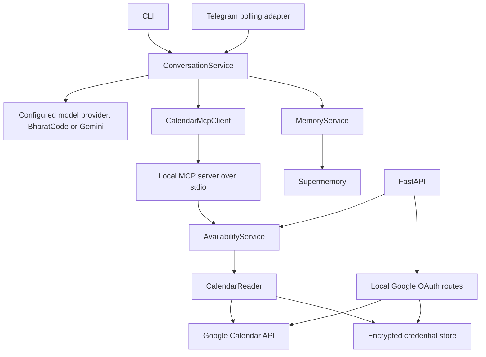
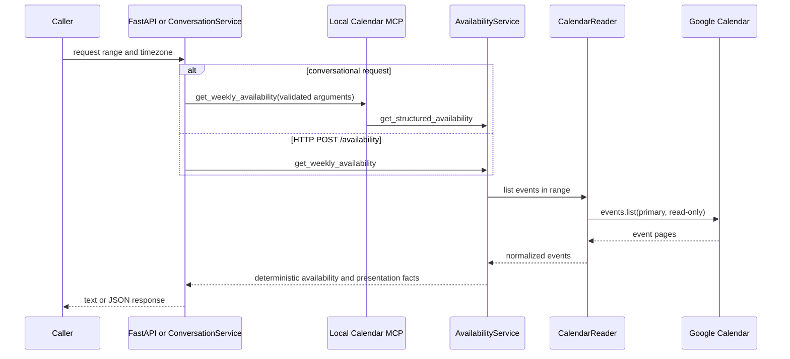
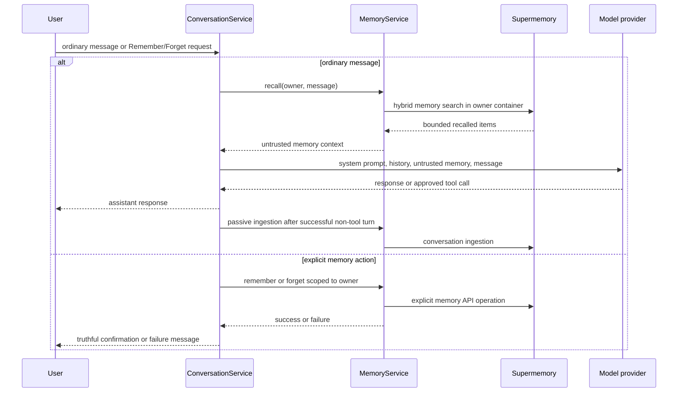

# Architecture

## System overview

PAM is a Python 3.12 assistant. CLI and Telegram input reaches `ConversationService`, which asks the configured model provider for a reply. A provider may request the single approved Calendar tool. PAM invokes a private local MCP client/server pair and returns the structured result to the provider. PAM can also recall and ingest durable user memory through Supermemory. FastAPI exposes health, availability, and local Google OAuth endpoints; it is not the Telegram transport.

### Component responsibilities

| Component | Responsibility | Important boundary |
| --- | --- | --- |
| CLI / Telegram adapter | Converts input to a session and memory owner; renders a text response. | Neither adapter calls Google directly. |
| `ConversationService` | Serializes a session, recalls memory, runs the bounded provider/tool loop, commits transient history, and handles `/new`. | It permits only `get_weekly_availability`. |
| BharatCode / Gemini adapters | Convert provider SDK requests/responses to provider-neutral model types. | Provider output is untrusted. |
| `CalendarMcpClient` and local MCP server | Discover and execute the one Calendar MCP tool over local stdio. | MCP is private, not an Internet-facing Calendar API. |
| `AvailabilityService` | Validates date range policy and calculates deterministic free/busy availability. | It maps reader failures to `CalendarUnavailable`. |
| `CalendarReader` | Reads primary-calendar events through the configured backend. | Google credentials stay below this layer. |
| Credential store | Encrypts only the OAuth refresh credential at rest with Fernet. | It never returns a credential to HTTP responses. |
| `MemoryService` | Bounded recall, explicit memory actions, and passive conversation ingestion. | Recalled content is untrusted context. |

## Availability request flow

The FastAPI endpoint is direct; the conversational route has the same availability service behind MCP.

`AvailabilityService` clips and merges busy intervals. Phase 10's presentation builder supplies stable dates, free windows, candidate slots, and weekly facts. Candidate slots are factual intervals, not promises that an event can be created; Calendar writes are unsupported. See [AVAILABILITY_PRESENTATION.md](AVAILABILITY_PRESENTATION.md).

## Memory lifecycle

## Trust boundaries and data flow

* **User input, model output, recalled memory, and remote API responses are untrusted.** Model requests cannot select arbitrary tools; memory is labelled untrusted context in provider prompts.
* **The Calendar tool is read-only.** Its MCP schema rejects extra or malformed inputs, and `ConversationService` rejects every tool name except the one allowlisted name.
* **OAuth secrets and refresh credentials are sensitive.** Environment values provide OAuth client configuration; the refresh credential is encrypted locally and is not logged or returned by OAuth routes.
* **Session history is transient.** The default store is in-memory and `/new` clears it. Durable memory is separate and can survive a new store instance.
* **Logging is structured and redacted.** Request IDs support correlation; operators should not add prompts, credentials, tokens, or provider payloads to logs.
