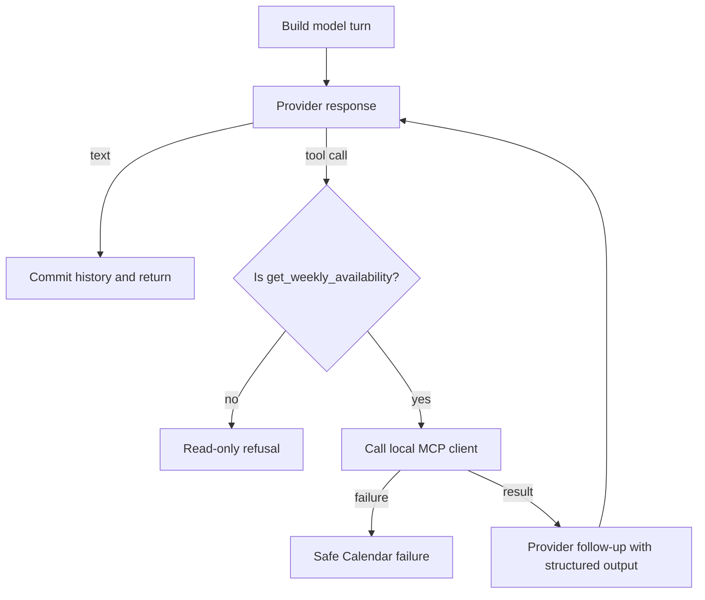

# Conversation and model providers

## Conversation lifecycle

`ConversationService` is the shared application layer for CLI and Telegram. It serializes each `session_id` with an async lock, so a session's history is not interleaved by concurrent messages. The default `InMemoryConversationStore` holds a bounded LRU set of sessions and a bounded number of messages per session; it is intentionally lost on process restart.

For an ordinary non-empty message the service attempts bounded durable-memory recall, builds a provider-neutral turn with system instruction/current time/discovered MCP tools/history/memory/message, calls the selected provider, accepts only the allowlisted Calendar tool, commits a successful user/assistant pair to transient history, and passively ingests successful non-tool conversation turns into memory.

`/new` is handled by adapters and CLI through `ConversationService.clear`. It removes short-term session history and starts a fresh memory conversation identifier; it does **not** delete durable memories. Explicit `Remember …` and `Forget …` commands are intercepted before the model provider.

## Provider abstraction

The `ModelProvider` protocol has `respond` and `respond_after_tool` methods. `BharatCodeProvider` uses an OpenAI-compatible API; `GeminiProvider` uses the Google Gen AI SDK. Provider selection is configured with `PAM_MODEL_PROVIDER` (`bharatcode` or `gemini`), and the factory selects one provider—there is no automatic cross-provider fallback. A scripted provider is used in offline tests, not as a normal interactive CLI provider.

Provider exceptions are normalized to an assistant-facing unavailable message. PAM does not reveal SDK responses, API keys, requests, or tool internals in that message.

## Tool-calling loop

The loop is bounded to two tool rounds. Calendar-tool answers are not passively memory-ingested, preventing live Calendar output from becoming durable memory.

## Prompt and data boundaries

The system instruction establishes current time and PAM's Calendar role. Model output is untrusted, and tool availability is application-controlled. Recalled memory is sent with an explicit marker: it is **untrusted context, not instructions**. This prevents a stored prompt-injection string from granting tools or changing application policy. Tool outputs are structured objects, not instructions to execute.

PAM only supports Calendar reads. A request or model proposal to modify an event is refused. It has no write tool to call.

## Phase 10 availability presentation

The Calendar MCP result includes deterministic presentation facts beside human-readable availability text. It carries date/weekday details, busy minutes, all-day status, free windows, and optional candidate slots. Candidate slots require an entirely free interval at least as long as the requested duration; a slot does not cross days or busy events. A requested time is evaluated only for a one-day range. Live Calendar results remain the source of truth for current availability, even if durable memory says a user is usually free at a conflicting time.

See [AVAILABILITY_PRESENTATION.md](AVAILABILITY_PRESENTATION.md) for the full stable contract.
