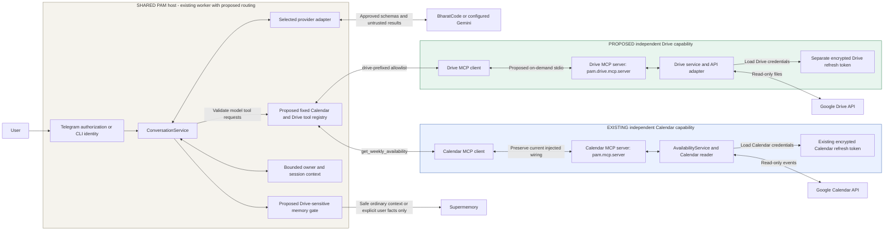
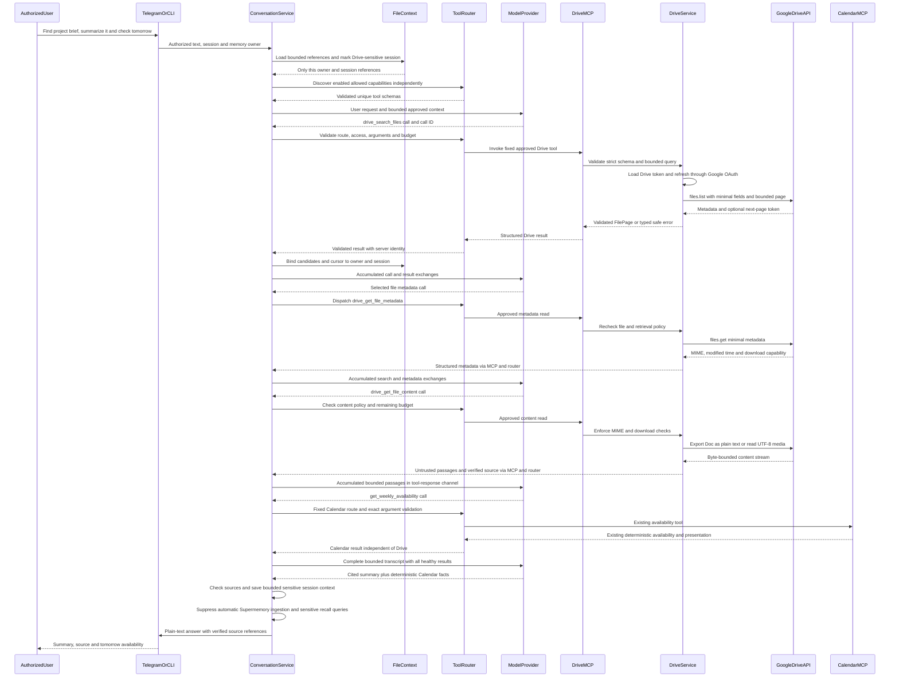

# Proposed Google Drive MCP workflow and architecture

**Historical diagrams:** the independent-server layout below and the linked
FigJam board predate the 2026-10-17 architecture revision. The current design uses
one `pam/mcp/server.py`, existing `calendar.py` and proposed `driver.py`, with
shared helpers where useful. See the authoritative
[Stage 1 boundaries](STAGE_01_BOUNDARIES.md). Do not implement the separate Drive
package/process or multi-server registry depicted here. User-level retrieval,
consent and validation requirements remain applicable; refreshed diagrams are
deferred until the layout is reviewed.

Status: review draft, generated 2026-10-16 from the
[implementation plan](GOOGLE_DRIVE_IMPLEMENTATION_PLAN.md), audited repository
baseline `77a2ebf`. Drive integration is not implemented. These diagrams make the
proposed design concrete; they do not approve open decisions or describe a deployed
Drive feature. Existing Calendar behavior is shown separately for comparison.

[Open the editable diagram board](https://www.figma.com/board/mRYc91quwpzXk6JRAPPNET).
The Mermaid blocks below are the reviewable source of each view and remain usable
without FigJam. No application code, credentials, configuration or deployment is
changed by this document. The existing plan and Docs index were local and
uncommitted when this diagram work began; nothing has been pushed by this task.

Read the views in order: user workflow, high-level architecture, low-level
request sequence, then OAuth setup. Calendar is not invoked for a Drive-only task.
A combined task shares only the orchestrator and final answer, not the servers,
domain models, credentials, API adapters or error state.

## 1. Complete user workflow

This view follows a Telegram request from authorization through intent resolution,
file lookup, content retrieval, safe composition, and reply. The CLI enters at
its configured local identity instead of Telegram's private-chat check. A combined
request follows both capability branches and returns the healthy results together.
The branches are logical routes, not permission to run unbounded parallel work.

A candidate list or clarification is a reply, not a failed attempt to guess the
file. The user's next message re-enters authorization; the selected reference is
bound to that owner/session. More results require an explicit request for the next
bounded page. The `/new` command clears transient context without revoking grants
or deleting durable memories.

```mermaid
flowchart LR
  message["User sends a Telegram message"]
  access{"Allowed user and private chat?"}
  denied["Reject before model or tool access"]
  command{"New conversation command?"}
  reset["Clear history, references and Drive-sensitive state"]
  intent{"Resolve intent and context"}
  clarify["Ask user to clarify"]
  plain["Normal conversation without file retrieval"]
  subgraph driveFlow ["PROPOSED Drive flow"]
    drivePolicy{"Drive enabled and user permitted?"}
    driveOff["Explain Drive unavailable or access denied"]
    fileRef{"Known file reference?"}
    search["Search or list one bounded page"]
    selection{"Unique file selected?"}
    candidates["Show candidates or next-page option"]
    metadata["Read fresh file metadata"]
    contentNeed{"Content requested?"}
    supported{"Supported MIME and download permitted?"}
    readContent["Export Google Doc or read UTF-8 text"]
    limits{"Within byte and context limits?"}
    driveError["Return safe Drive-only error"]
    driveFacts["Validated metadata or untrusted passages with sources"]
  end
  subgraph calendarFlow ["EXISTING Calendar flow"]
    calendarTool["Get weekly availability"]
    calendarFacts["Deterministic availability and presentation"]
  end
  compose["Compose answer from healthy results and source citations"]
  memory["Bounded session context; suppress automatic memory for Drive-sensitive session"]
  reply["Reply in Telegram; same conversation policy in CLI"]
  message --> access
  access -->|"No"| denied
  access -->|"Yes"| command
  command -->|"Yes"| reset
  command -->|"No"| intent
  intent -->|"Unclear referent"| clarify
  intent -->|"General chat"| plain
  intent -->|"Drive or combined"| drivePolicy
  intent -->|"Calendar or combined"| calendarTool
  drivePolicy -->|"No"| driveOff
  drivePolicy -->|"Yes"| fileRef
  fileRef -->|"No"| search
  fileRef -->|"Yes"| metadata
  search --> selection
  selection -->|"No or ambiguous"| candidates
  selection -->|"Yes"| metadata
  metadata --> contentNeed
  contentNeed -->|"No"| driveFacts
  contentNeed -->|"Yes"| supported
  supported -->|"No"| driveError
  supported -->|"Yes"| readContent
  readContent --> limits
  limits -->|"No"| driveError
  limits -->|"Yes"| driveFacts
  calendarTool --> calendarFacts
  driveFacts --> compose
  calendarFacts --> compose
  driveError --> compose
  driveOff --> compose
  plain --> reply
  compose --> memory
  memory --> reply
  candidates --> reply
  clarify --> reply
  reset --> reply
  style driveFlow fill:#E8F5EE,stroke:#237A4B
  style calendarFlow fill:#EAF1FF,stroke:#3562AD
```

Existing authorization and Calendar behavior remain. Drive branch, combined routing and memory protections are proposed. Follow-up replies re-enter the same authorization flow.

## 2. High-level architecture

This is a logical component view of the target design. The groups show ownership
boundaries, not independently deployed microservices. Shared request handling,
provider adapters, logging, configuration and encryption code stay in one PAM
repository. One PM2 Telegram worker remains the long-lived process. Proposed
Drive stdio sessions are started on demand and reaped after use; Calendar keeps
its current injected server wiring unless a later reviewed change consolidates it.

Green is proposed Drive capability. Blue is existing Calendar capability. Neutral
is shared infrastructure that needs the planned routing and memory extensions.
There is no dependency from Drive domain/service/API code to Calendar domain code.
The model proposes calls; the registry controls whether they can run.

Logical component view, not a microservice deployment diagram. One repository and one PM2 Telegram worker; Drive child sessions are temporary. No Drive-to-Calendar domain dependency. Separate files do not guarantee independent Google grant revocation.

## 3. Low-level request sequence

Example: an authorized user asks to find and summarize a project brief, then
check tomorrow's availability. This shows the successful, unambiguous case with
four sequential tool invocations: search, metadata, content, Calendar. An ambiguous
search pauses for user selection. A known safe file reference can skip search.

Every call passes the host-owned registry, access policy, schema/result validation
and remaining deadline/budget. Result exchanges accumulate in the model transcript
so the Calendar response does not replace the earlier Drive results. The provider
adapter is BharatCode by default where configured; Gemini follows the same portable
contract. `ModelProvider` in this sequence represents the adapter and its configured
hosted model. A Drive credential refresh contacts Google's OAuth token endpoint,
not the Drive files endpoint. No refresh token is sent to the model.

Service-to-conversation return arrows labeled "via MCP and router" abbreviate the
reverse path through DriveMCP and ToolRouter; they do not bypass result validation.
Error branches and cleanup are specified in section 6 below.

Proposed successful sequential example. Ambiguous search pauses for selection; errors return through the same router. Abbreviated service-to-conversation returns traverse Drive MCP and ToolRouter in reverse. Refresh uses Google's token endpoint, not the Drive API.

## 4. Separate OAuth provisioning flow

This is operator setup, not part of a normal chat request and not an MCP tool.
The dedicated Drive client and distinct encrypted token path are the plan's
recommended starting point. Scope, client/project separation, account binding,
verification and independently revocable grants still need architecture review.
Separate token files guarantee neither separate consent nor independent revocation.

After successful Drive consent, verify the required granted scopes and refresh
before enabling access. Denied or partial consent must leave existing credentials
usable. Preserve the Calendar scope, credential path and consent behavior.

```mermaid
flowchart LR
  operator["Operator provisions Drive locally"]
  config["Dedicated Drive client and distinct credential path"]
  state["Create one-use state, PKCE and expiry"]
  consent["Google consent for approved Drive scope"]
  callback["Local Drive callback validates state and verifier"]
  grant{"Required scopes and account binding valid?"}
  failed["Safe failure; preserve existing credentials"]
  persist["Atomically save encrypted Drive token and protected grant metadata"]
  acceptance["Refresh and test Drive reads"]
  regression["Verify existing Calendar still reads"]
  enable["Enable Drive for permitted owner"]
  calendarStore["Existing Calendar token file remains unchanged"]
  operator --> config
  config --> state
  state --> consent
  consent --> callback
  callback --> grant
  grant -->|"No or consent denied"| failed
  grant -->|"Yes"| persist
  persist --> acceptance
  acceptance --> regression
  regression --> enable
  config -.->|"Never overwrite"| calendarStore
```

Proposed provisioning flow, separate from normal messages and MCP tools. Dedicated client is a recommendation; consent/project boundary, granted scopes, verification and revocation independence still require review.

## 5. Low-level component and data contracts

All Drive paths and the tool router/reference store below are proposed. Calendar
paths refer to existing components. See the plan for the exact reuse matrix and
stage-by-stage tests.

| Boundary | Components | Owned contract |
| --- | --- | --- |
| Shared orchestration | `pam/conversation/service.py`, `models.py`, `provider.py`, proposed `tool_router.py` | Authorized session/owner, fixed registry, accumulated call/result exchanges, limits and partial failures. Registry maps public tool name to fixed server, validator and access policy. |
| File references | Proposed `pam/conversation/file_context.py` | IDs/cursors bound to owner, session, query and grant; bounded expiry/capacity; clear on `/new`, account change and eviction. File IDs alone do not grant access. |
| Drive boundary | Proposed `pam/drive/mcp/server.py`, `tools.py` | Independent entry point `python -m pam.drive.mcp.server`; strict approved read-only schemas. |
| Drive policy/domain | Proposed `pam/drive/service.py`, `models.py`, `reader.py` | FileMetadata, FilePage, FileContent, safe errors; validation, MIME policy, content limits, reader interface and fake. No Calendar imports. |
| Drive adapter | Proposed `pam/drive/google_drive.py`, `wiring.py` | Drive v3 list/get/export/media mapping, minimal fields, download-capability checks and Drive-specific credentials. |
| Shared Google plumbing | Proposed extraction `pam/integrations/google_oauth.py`; existing `pam/security/credentials.py` | Explicit scoped OAuth and encrypted token mechanics reused by each capability; no business-domain routing. |
| Calendar boundary | Existing `pam/mcp/server.py`, `calendar.py`; `pam/application/availability_service.py`; `pam/integrations/google_calendar.py` | Existing availability tool and deterministic presentation, Calendar-specific validation and errors. |
| Model serialization | Existing `pam/conversation/bharatcode.py`, `gemini.py`, modified as planned | Bounded untrusted tool responses, accumulated transcript, matching call IDs; never Google credentials or model-supplied routing authority. |
| Transport and memory | Existing `pam/telegram/adapter.py`, `bot.py`, `pam/conversation/cli.py`, `pam/memory/service.py` | Existing identity/authorization preserved; upstream Drive-sensitive policy blocks automatic document-derived durable memory. |

| Capability | Public tool | Input and output |
| --- | --- | --- |
| Drive | `drive_search_files` | Bounded search/filter/cursor → FilePage with metadata, next cursor and incomplete-search flag. |
| Drive | `drive_list_files` | Optional folder and bounded page/cursor → FilePage. No exhaustive background scan. |
| Drive | `drive_get_file_metadata` | Validated file reference → minimal metadata, MIME, modified time and retrieval capability. |
| Drive, D6 only | `drive_get_file_content` | Validated file reference → bounded untrusted passages, source identity, modified time and verified citation. |
| Calendar, existing | `get_weekly_availability` | Dates/timezone and optional duration/time → existing availability string and deterministic presentation object. |

First-release content support is Google Docs exported to plain text and uploaded
UTF-8 plain text. Other files can have searchable metadata but no content summary.
Folders and shortcuts are metadata-only initially. Model output cites verified
source links/passage labels; it does not invent document page numbers.

Starting limits remain proposals from the plan: 50 files/page, one page per tool
invocation, three explicitly requested pages per turn, six Drive/combined tool
calls, two Calendar-only tool rounds, 1 MiB transferred bytes per file, 20,000
extracted characters per file and 40,000 total per turn, plus a separately enforced
provider-token budget. Proposed discovery/call/tool-work deadlines are 5/20/60
seconds, with 10-second Drive HTTP timeout and at most two retry attempts within
the remaining budget. Validate actual SDK cancellation and VM headroom before
claiming these as production guarantees.

## 6. Branches, isolation and cleanup

| Trigger | Exact intended behavior | Calendar impact |
| --- | --- | --- |
| Unauthorized Telegram user or non-private chat | Reject before conversation/model/discovery/API access. | No Calendar invocation. |
| Authorized user outside initial Drive audience | Reject Drive capability before discovery or invocation; retain permitted Calendar capabilities. | Existing policy applies independently. |
| Drive disabled or missing grant | Do not expose usable Drive tools; return a safe Drive setup/unavailability explanation. | Calendar discovery and reads continue. |
| One server fails discovery | Keep healthy server tools; do not erase the whole registry. | Failure remains bound to the failing server. |
| Invalid/unknown/colliding tool or extra arguments | Reject before API I/O; never guess a route or execute writes. | Existing availability name/schema preserved. |
| Missing, duplicate or stale file reference | Ask for selection/new lookup; revalidate current metadata and access. | No Calendar fallback for missing files. |
| More results requested | Validate owner/session/query-bound cursor and fetch a bounded next page; report incomplete search. | No effect. |
| Unsupported MIME, denied download or oversized content | Return a typed Drive error; do not attempt another parser or arbitrary URL fetch. | Keep valid Calendar result in a combined answer. |
| 429, retryable quota reason or transient API failure | Apply bounded reason-based retry/backoff within deadline; otherwise return safe server-specific failure. | Healthy Calendar can still complete. |
| Calendar read fails | Return safe Calendar failure and keep any valid Drive result. | No fabricated availability from document text. |
| Embedded document instructions | Keep as untrusted content; they cannot grant tools, alter auth, change memory or trigger arbitrary requests. | Cannot alter deterministic Calendar facts. |
| Sensitive Drive session | Suppress automatic ingestion and unsafe recall queries, including later no-tool follow-ups until `/new`. | Calendar-only sessions retain existing memory policy. |
| Explicit Remember | Only specific user-supplied facts use existing owner-isolated memory action; never resolve a document into bulk persistence. | Existing explicit memory semantics preserved. |
| Cancel, timeout or shutdown | Close MCP context, stop/contain I/O, reap owned child, release concurrency slot; do not leave an unbounded thread/process behind. | No global client shutdown because only Drive failed. |
| `/new`, session eviction or account/grant change | Clear corresponding transient file/cursor/history state; preserve valid durable memory and grants as documented. | Deterministic Calendar behavior unchanged. |

## 7. Deployment and unresolved review gates

Retain one repository, one installed PAM package and one PM2 Telegram poller.
No permanent Drive worker, sync/index service, public MCP port or FastAPI service
is added for normal Telegram use. The Drive subprocess must receive only its
necessary settings; inherited `.env` loading must also be controlled, not just
its environment dictionary. Shared provider outages can affect both capabilities;
independent MCP failure handling cannot make the hosted model independent.

Review still needs to resolve Google scope and consent/verification requirements,
client/project grant isolation, protected grant metadata format, owner-only initial
Drive audience, hosted-model transfer/retention policy, token budget and measured
VM limits. No raw document persistence or automatic bulk synchronization is planned.
See the [open decisions in the implementation plan](GOOGLE_DRIVE_IMPLEMENTATION_PLAN.md#11-open-design-decisions-for-architecture-review).

These diagrams cover the proposed D1–D6 flow; D7 must prove live acceptance,
Calendar regression protection, resource limits and feature-disable/code rollback
before production rollout. Diagram generation does not authorize implementation,
commits, pushing or deployment.
