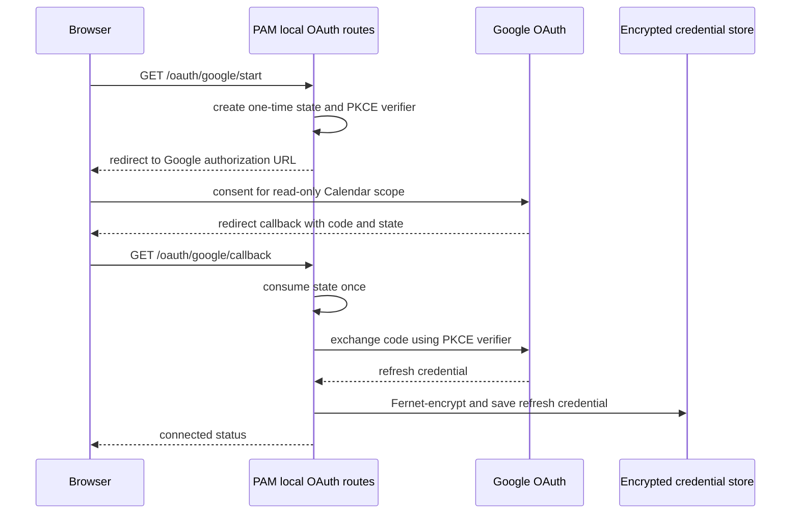
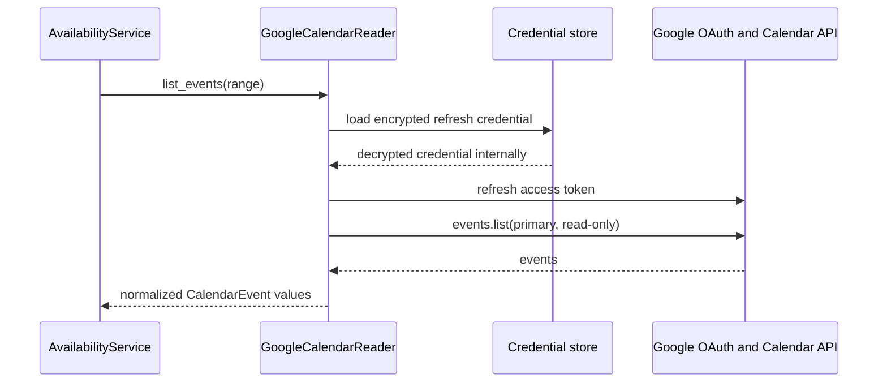

# Google Calendar integration

## What PAM uses

Google Calendar is an optional `PAM_CALENDAR_BACKEND=google` integration. PAM uses the read-only scope `https://www.googleapis.com/auth/calendar.events.readonly`. It lists events from the authenticated user's `primary` calendar and converts them to PAM's normalized event model. It does not create, edit, or delete events.

## Google Cloud setup

1. Create or select a Google Cloud project and enable the **Google Calendar API**.
2. Configure the OAuth consent screen. During development select the intended audience and add every account that will authorize while the app is in **Testing** status.
3. Create a **Web application** OAuth client.
4. Register the redirect URI exactly as `PAM_GOOGLE_REDIRECT_URI`, for example `http://127.0.0.1:8000/oauth/google/callback` locally. A deployed service needs its own exact redirect URI.
5. Set the Google client ID, client secret, redirect URI, and a Fernet key in an ignored `.env` file locally or in the service environment. Never commit them.

Required Google-mode settings are `PAM_GOOGLE_CLIENT_ID`, `PAM_GOOGLE_CLIENT_SECRET`, `PAM_GOOGLE_REDIRECT_URI`, and `PAM_CREDENTIAL_ENCRYPTION_KEY`. `PAM_CREDENTIAL_STORAGE_PATH` controls where the encrypted refresh credential is stored.

## Authorization flow

The state value is random, process-local, and consumed once. Restarting PAM, reusing an old callback URL, or opening a callback after a reload can therefore produce `400 {"detail":"invalid OAuth state"}`; begin the flow again from `/oauth/google/start` in the same running process.

PAM stores only the refresh credential. `EncryptedFileCredentialStore` uses the configured Fernet key and attempts restrictive file permissions on systems that support them. Keep the encrypted credential file and its Fernet key together for a given environment; replacing either prevents decryption.

## Reading and refresh behavior

On an availability request, `GoogleCalendarReader` loads and decrypts the refresh credential, constructs Google credentials, refreshes an access token, then calls `events.list` for the requested time window while handling pagination. The access token is not persisted by PAM.

## Errors and public behavior

The Google reader normalizes absent, undecryptable, invalid, expired/revoked, or refresh-failed credentials into `GoogleReconnectRequired`. The availability service maps any reader failure into `CalendarUnavailable`. The public API maps that domain error to `HTTP 503` with `{"detail":"calendar is unavailable"}`. This avoids exposing whether credentials are missing, a refresh failed, or Google returned an upstream error. The MCP tool similarly returns a generic Calendar-unavailable/reconnection message.

`invalid_grant` from Google's refresh endpoint normally means the refresh credential is no longer usable (for example revoked, expired, invalidated, or issued under a Testing-mode policy). It is a reauthorization issue, not a reason to expose credentials or weaken error handling.

### Testing-mode refresh tokens

For an external OAuth consent screen in **Testing**, Google refresh tokens can expire after seven days for many configurations. Add the authorizing account as a test user, expect periodic local reauthorization, and consult current Google OAuth policy before production use. Publishing the consent screen can remove development-only restrictions, but may introduce verification, branding, privacy-policy, and sensitive-scope requirements. Publishing is an operational/product decision, not a PAM code switch.

## Safe reauthorization

1. Stop or otherwise ensure only one local PAM process is handling the OAuth callback.
2. Confirm the registered redirect URI exactly matches the environment's `PAM_GOOGLE_REDIRECT_URI`.
3. Start PAM, open `/oauth/google/start`, complete consent with an allowed test user, and wait for `{"status":"connected"}`.
4. Re-run a read-only availability request.

Do not hand-edit, print, commit, or send the credential file. Reauthorization replaces the stored credential through the configured encrypted store. On Azure the OAuth client redirect URI, Fernet key, and credential storage path must be the server values, not local workstation values.

## Troubleshooting checklist

| Symptom | Safe check / action |
| --- | --- |
| OAuth start returns 503 | Verify Google mode and required configuration names; do not print values. |
| OAuth callback says invalid state | Restart the flow; use the new URL in the same running PAM process. |
| Callback says authorization failed | Verify client/redirect configuration and repeat consent; inspect protected logs for error type only. |
| `/availability` returns 503 | Check credential-file presence/permissions, Fernet-key continuity, then reauthorize if logs show reconnect required. |
| `invalid_grant` in protected logs | Safely reauthorize; do not retry with a leaked or old refresh credential. |
| Google rejects access | Confirm API enabled, correct OAuth project/client, consent audience/test-user membership, and read-only scope. |
