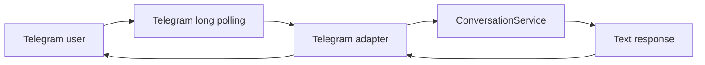

# Telegram integration

## Architecture

`pam.telegram.bot` is a polling process, not a FastAPI webhook. It creates the configured model provider, local MCP client, memory service, in-memory conversation store, and real Telegram adapter. The adapter only authenticates and translates Telegram updates into calls to `ConversationService`.



## Access control and sessions

Telegram is enabled with `PAM_TELEGRAM_ENABLED=true`, a bot token, and `PAM_TELEGRAM_ALLOWED_USER_IDS`. The settings model expects allowed IDs as a tuple-compatible value rather than a bare integer. The adapter accepts only private chats from listed numeric user IDs. Unlisted users receive `Access denied.` and do not reach the conversation service.

The authenticated Telegram user supplies both `telegram:<user-id>` as the session ID and that user ID as the memory owner. This keeps short-term session history and durable memory scoped to the same Telegram identity.

## Commands and formatting

| Input | Behavior |
| --- | --- |
| `/start` | Sends a short PAM introduction. |
| `/help` | Sends supported-use guidance. |
| `/new` | Clears the user's transient conversation history. |
| ordinary text | Passes text to `ConversationService`. |

Incoming text and each outgoing message are capped at 4,096 characters. Long replies are split at newlines where possible, then spaces, and finally exact limits. PAM intentionally sends plain text without Telegram parse mode: provider output is untrusted, so avoiding Markdown/HTML parsing prevents formatting injection and malformed-message failures.

## Start and local test

From an activated, synchronized project environment run:

```powershell
python -m pam.telegram.bot
```

Use an allowlisted account and send `/start`, `/help`, `/new`, and a normal question. Do not paste a bot token into shell history, source control, logs, or support messages. If a token is ever exposed, rotate it through BotFather and update the protected environment value.

## Errors and production operation

The adapter returns safe generic error text if the application service fails; it does not expose provider, Google, memory, or token details. The bot process uses long polling, so it needs outbound connectivity to Telegram but no publicly reachable FastAPI endpoint. In production PM2 supervises this polling process; see [PRODUCTION_DEPLOYMENT.md](PRODUCTION_DEPLOYMENT.md).

Offline tests cover authorization, command handling, session ownership, message splitting, reply limits, and the real-adapter/in-memory-service flow without contacting Telegram.
